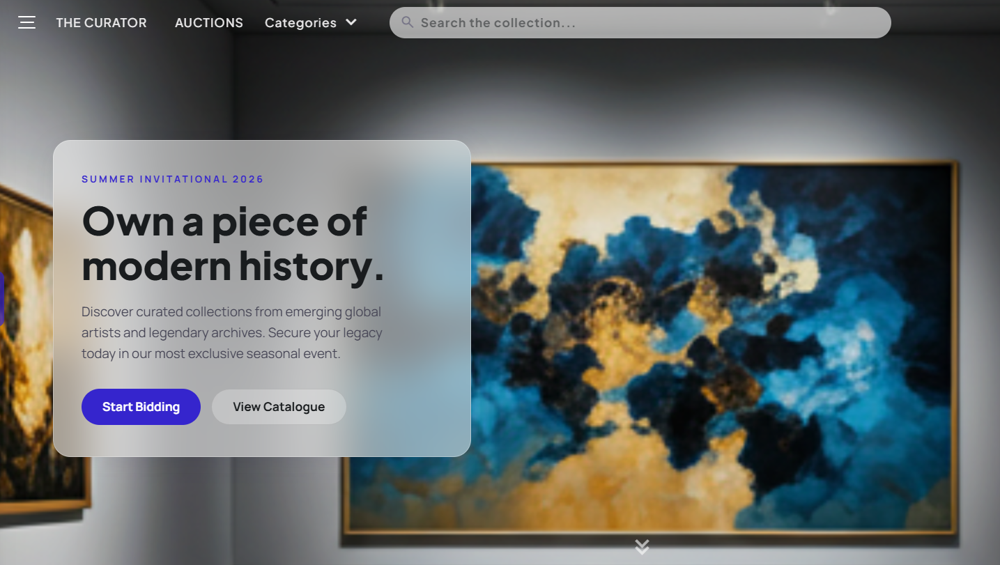
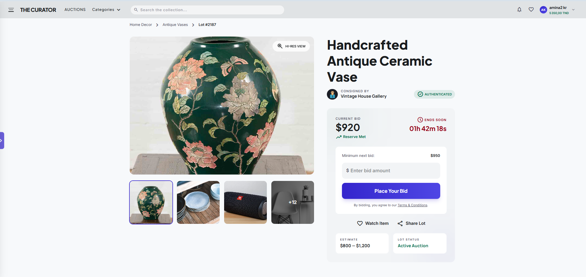
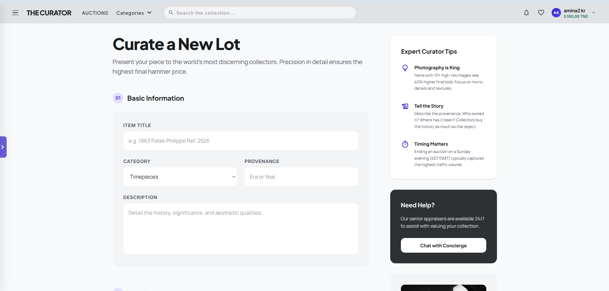
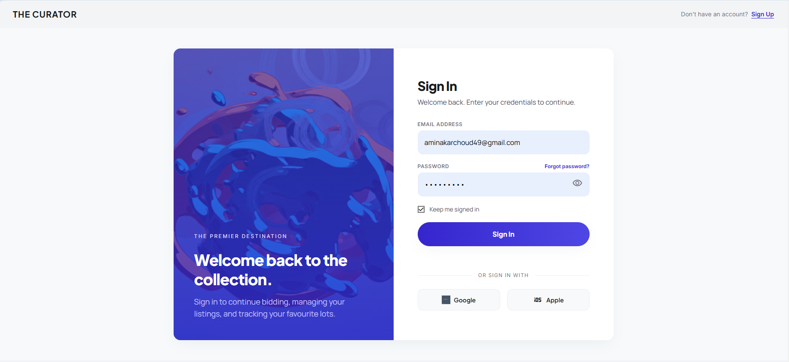

# AuctionSite — The Curator

A dual-currency auction platform built with React, NestJS, and Solana.

## About

An end-of-year academic project developed at EPI Digital School. The platform combines traditional auctions using Tunisian Dinar (TND) with blockchain-based auctions using Solana (SOL).

## Technologies

- React and TypeScript
- Vite
- NestJS and Node.js
- Supabase
- Docker
- Solana and Rust
- Anchor Framework

## Architecture

The project contains:

- A React frontend
- An API Gateway
- User Service
- Auction Service
- Bidding Service
- Blockchain Service
- Payment Service
- Messaging Service
- Notification Service
- A Solana Anchor program

## Screenshots

### Home Page

### Auction Details

### Create Auction

### Login

### Messaging

EPI Digital School — Academic Year 2024–2025
